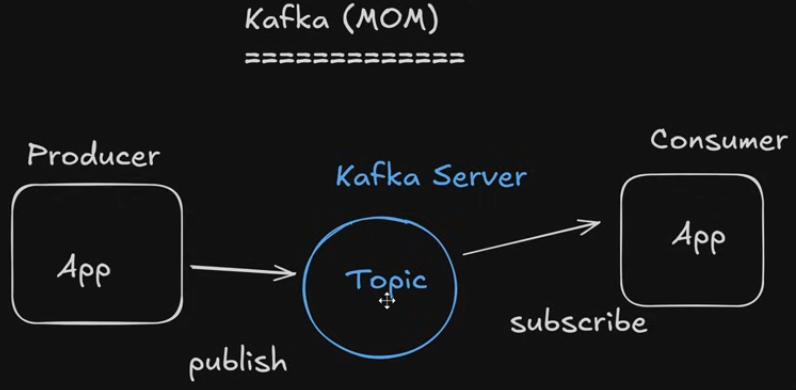
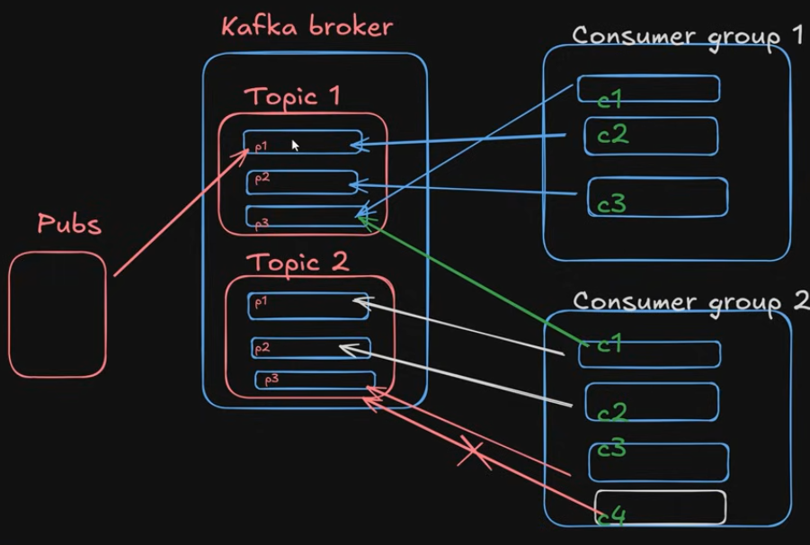
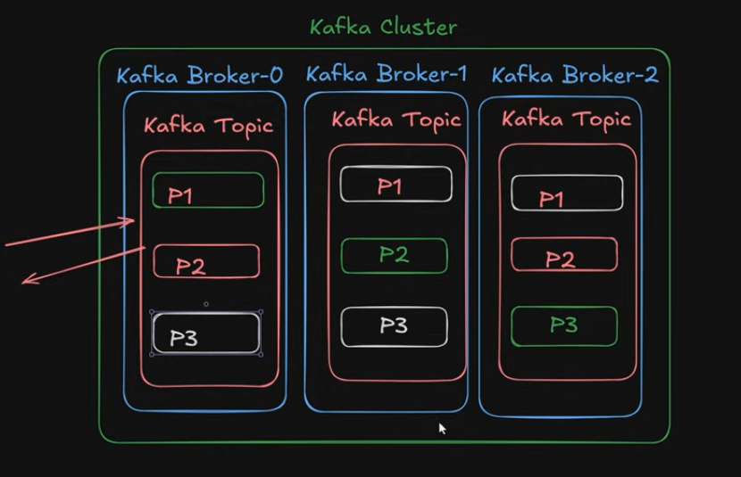

# Apache Kafka (MOM)

## Overview Architecture

Kafka is a distributed event-streaming platform enabling asynchronous communication between applications.

### Main Components
- **Producer:** Publishes messages (events) to Kafka Topics.
- **Broker:** Kafka server that receives and stores messages.
- **Topic:** Logical category where related messages are stored.
- **Consumer:** Subscribes to Topics and reads messages.

### Architecture Diagram

### Key Benefits
- Asynchronous communication
- Loose coupling
- Scalability
- Fault tolerance

## Kafka Topics, Partitions & Consumer Groups

### Topics & Partitions
- **Topic:** Logical category for storing related messages.
- **Partition:** Ordered sequence of messages within a topic.
- A topic can contain multiple partitions.
- Message ordering is guaranteed within each partition.

### Consumer Groups
- **Consumer Group:** Multiple consumers working together to process messages.
- Each partition is assigned to only one consumer within a group.
- Different consumer groups can read the same partitions independently.
- If consumers > partitions, some consumers remain idle (for a single topic).

### Key Benefits
- **Parallelism:** Process partitions simultaneously.
- **Scalability:** Distribute partitions across multiple brokers.
- **Load balancing:** Distribute partition assignments among consumers.

### Architecture Diagram

## Kafka Cluster, Brokers & Replication

### Kafka Cluster
- **Cluster:** Group of Kafka brokers working together.
- **Broker:** Kafka server responsible for storing and serving partition data.
- Topic partitions can be distributed across multiple brokers.

### Partition Replication
- **Replication Factor (RF):** Number of copies of each partition.
- **Leader:** Handles reads and writes for a partition.
- **Follower:** Replicates data from the leader.
- If a leader fails, an eligible follower can become the new leader.

### Key Points
- RF = 1: No replication.
- RF = 3: Three replicas (1 leader + 2 followers).
- **Partitioning:** Scalability and parallelism.
- **Replication:** High availability and fault tolerance.

### Architecture Diagram

## ZooKeeper vs. KRaft in Kafka

### ZooKeeper (Legacy)
- External service used for Kafka cluster coordination.
- Manages broker metadata, controller election, and cluster coordination.
- Helps Kafka detect broker failures and coordinate leader elections.

### KRaft (Modern Kafka)
- **KRaft (Kafka Raft):** Kafka's built-in metadata management system.
- Replaces ZooKeeper with an internal controller quorum.
- Uses a Raft-based consensus protocol.
- Simplifies deployment and cluster management.

### Kafka Versions
- **Before 2.8:** ZooKeeper required.
- **2.8:** KRaft introduced (early access).
- **3.3:** KRaft production-ready.
- **4.0+:** KRaft only; ZooKeeper removed.

## Kafka Producer

A **Producer** is an application that publishes messages (events) to Kafka topics.

### Responsibilities
- Sends messages to Kafka brokers.
- Publishes messages to specific topics.
- Determines the target partition.

### Partition Selection
- **Key-based:** Same key generally maps to the same partition, preserving ordering per key.
- **Round-Robin:** Distributes messages cyclically across partitions.
- **Sticky Partitioning:** Default behavior for keyless messages in modern Kafka producers, improving batching efficiency.

### Key Points
- Producers do not need to know which consumers will read their messages.
- Enables asynchronous communication and loose coupling.
- Message ordering is guaranteed within a partition.

### Sticky Partitioning

- Kafka producer strategy for messages without keys.
- Sends multiple messages to the same partition before switching to another.
- Improves batching, throughput, and network efficiency.
- Typically used by default for keyless messages in modern Kafka producers.

**Example:**
M1, M2, M3 → P1
M4, M5, M6 → P3

**Difference:**
- Round-Robin: Rotates partitions per message.
- Sticky: Groups messages into batches per partition.

